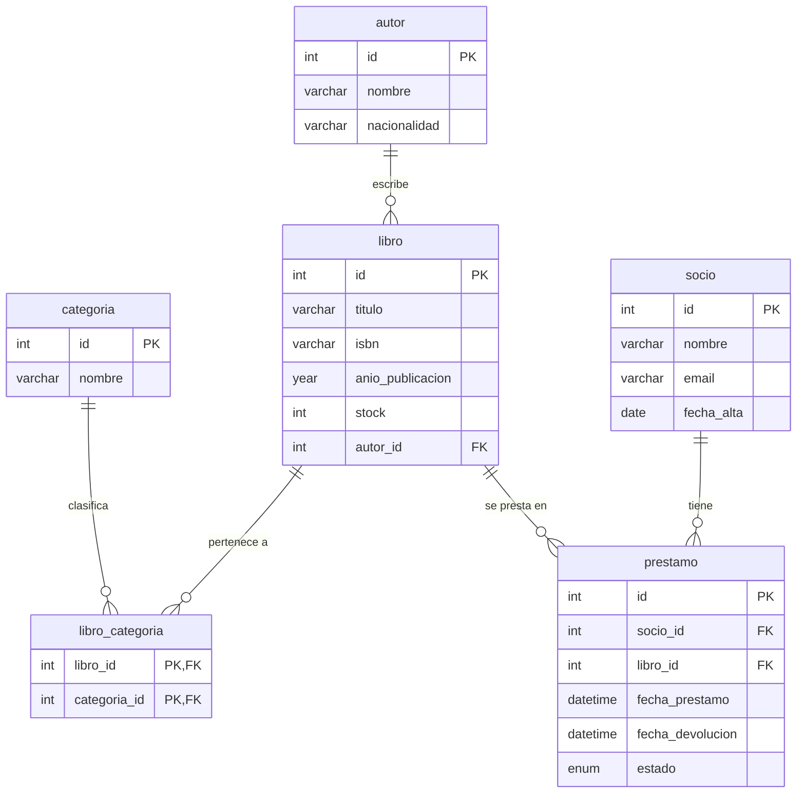
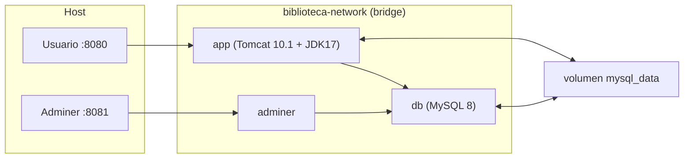

# Biblioteca - Gestión de Préstamos

Aplicación web full-stack para la gestión de una biblioteca: catálogo de libros, autores, categorías, socios y control de préstamos.

## Stack Tecnológico

| Capa | Tecnología |
|---|---|
| Backend | Java 17, Jakarta Servlet 6.0, JDBC puro |
| Base de datos | MySQL 8.0 |
| Pool de conexiones | Apache Commons DBCP2 |
| JSON | Jackson |
| Frontend | HTML5, CSS3, JavaScript ES modules |
| Tests | JUnit 5, Mockito, Testcontainers |
| Build | Maven |
| Contenedores | Docker, Docker Compose |
| Servidor | Tomcat 10.1 |

## Diagrama Entidad-Relación



## Arquitectura de Contenedores



## Arquitectura por Capas

```
HTTP Request → ErrorHandlingFilter → Controller Servlet → Service → DAO JDBC → MySQL
```

- **Controller:** Gestiona HTTP, valida formato, llama al servicio, serializa JSON.
- **Service:** Reglas de negocio, validaciones, transacciones (commit/rollback).
- **DAO:** Único lugar con SQL. PreparedStatement siempre, try-with-resources.
- **DTO:** Objetos de transferencia obligatorios. Las entidades nunca se exponen en la API.

## Estructura de Carpetas

```
pro003/
├── pom.xml
├── Dockerfile
├── docker-compose.yml
├── .env.example
├── .gitignore
├── db/
│   └── init.sql
├── src/main/java/com/biblioteca/
│   ├── config/      (DataSourceProvider)
│   ├── controller/  (Servlets REST)
│   ├── dao/         (Acceso a datos JDBC)
│   ├── dto/         (DTOs de respuesta y request)
│   ├── exception/   (Excepciones personalizadas)
│   ├── mapper/      (Mappers entidad ↔ DTO)
│   ├── model/       (Entidades)
│   ├── service/     (Reglas de negocio)
│   └── util/        (JsonUtil, ErrorHandlingFilter, TransactionManager.java)
├── src/test/java/com/biblioteca/util/
│   └── TransactionManagerTest.java
└── src/main/webapp/
    ├── index.html
    ├── autores.html, categorias.html, libros.html, socios.html, prestamos.html
    ├── css/styles.css
    └── js/api.js
```

`db/repair-utf8-mojibake.sql` es una herramienta manual para reparar datos con mojibake; no se ejecuta automáticamente al iniciar Compose.

## Variables de Entorno

| Variable | Descripción | Ejemplo |
|---|---|---|
| `MYSQL_ROOT_PASSWORD` | Contraseña root de MySQL (obligatoria en Compose) | `root_password` |
| `DB_HOST` | Host de la base de datos | `db` |
| `DB_PORT` | Puerto de la base de datos | `3306` |
| `DB_NAME` | Nombre de la base de datos | `biblioteca_db` |
| `DB_USER` | Usuario de la base de datos | `biblioteca_user` |
| `DB_PASSWORD` | Contraseña de la base de datos | `biblioteca_pass` |
| `DB_POOL_MAX` | Conexiones máximas del pool | `10` |
| `DB_POOL_MIN` | Conexiones mínimas del pool | `2` |
| `DB_POOL_IDLE` | Conexiones inactivas máximas | `5` |

## Instrucciones de Uso

### 1. Clonar el repositorio

```bash
git clone <url>
cd pro003
```

### 2. Configurar variables de entorno

```bash
cp .env.example .env
# Editar .env si es necesario
```

### 3. Arrancar la aplicación

```bash
docker compose up --build -d
```

### 4. Comprobar que todo funciona

```bash
docker compose ps
# db debe estar healthy
# app debe estar running
```

### 5. Acceder a la aplicación

- **Aplicación web:** http://localhost:8080
- **Adminer:** http://localhost:8081
  - Sistema: MySQL
  - Servidor: `db`
  - Usuario: `biblioteca_user`
  - Contraseña: `biblioteca_pass`
  - Base de datos: `biblioteca_db`

## Credenciales de Prueba

| Usuario | Contraseña |
|---|---|
| `biblioteca_user` | `biblioteca_pass` |

## Puertos Expuestos

| Puerto | Servicio |
|---|---|
| `8080` | Aplicación web (Tomcat) |
| `8081` | Adminer |

MySQL escucha en el puerto `3306` dentro de la red privada de Compose; ese puerto no se publica en el host. `MYSQL_ROOT_PASSWORD`, `DB_NAME`, `DB_USER` y `DB_PASSWORD` son obligatorias en Compose; configura sus valores en `.env` a partir de `.env.example`.

## Endpoints de la API

| Método | Ruta | Descripción |
|---|---|---|
| GET | `/api/autores` | Listar autores |
| GET | `/api/autores/{id}` | Buscar autor por ID |
| POST | `/api/autores` | Crear autor |
| PUT | `/api/autores/{id}` | Actualizar autor |
| DELETE | `/api/autores/{id}` | Eliminar autor |
| GET | `/api/categorias` | Listar categorías |
| GET | `/api/categorias/{id}` | Buscar categoría por ID |
| POST | `/api/categorias` | Crear categoría |
| PUT | `/api/categorias/{id}` | Actualizar categoría |
| DELETE | `/api/categorias/{id}` | Eliminar categoría |
| GET | `/api/libros` | Listar libros (con filtros: `?titulo=&autor=&categoria=`) |
| GET | `/api/libros/{id}` | Buscar libro por ID |
| POST | `/api/libros` | Crear libro |
| PUT | `/api/libros/{id}` | Actualizar libro |
| DELETE | `/api/libros/{id}` | Eliminar libro |
| GET | `/api/socios` | Listar socios |
| GET | `/api/socios/{id}` | Buscar socio por ID |
| POST | `/api/socios` | Crear socio |
| PUT | `/api/socios/{id}` | Actualizar socio |
| DELETE | `/api/socios/{id}` | Eliminar socio |
| GET | `/api/prestamos` | Listar préstamos (con filtros: `?socio_id=&estado=`) |
| GET | `/api/prestamos/{id}` | Buscar préstamo por ID |
| POST | `/api/prestamos` | Crear préstamo |
| PUT | `/api/prestamos/{id}/devolucion` | Devolver préstamo |

## Reglas de Negocio

- No se puede prestar un libro sin stock.
- Un socio no puede tener más de 3 préstamos activos.
- No se puede devolver un préstamo ya devuelto.
- ISBN y email únicos (error 409).
- Validación de datos en servidor: campos obligatorios, formato email, rango de año.

## Ejecutar Tests

```bash
mvn clean test
```

Las pruebas de integración usan Testcontainers con MySQL `8.0.41` y necesitan que el daemon de Docker sea accesible desde el proceso Maven. Si Docker no está disponible, los tests de integración no pueden ejecutarse correctamente.

## Comprobar Persistencia

```bash
# Insertar un dato desde la app
# Detener contenedores
docker compose down
# Arrancar de nuevo
docker compose up -d
# El dato debe persistir

# Para reiniciar datos (borrar volumen):
docker compose down -v
docker compose up --build -d
```
